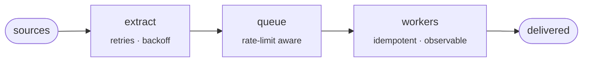

<picture>
  <source media="(prefers-color-scheme: dark)" srcset="https://readme-typing-svg.demolab.com?font=JetBrains+Mono&weight=500&size=18&duration=2200&pause=800&color=A5A1FF&multiline=true&repeat=false&width=640&height=110&lines=%24+whoami;Paulo+Ram%C3%ADrez+Ciani+%C2%B7+backend+%26+automation+%C2%B7+Chile;%24+cat+now.txt;messaging+%C2%B7+automation+pipelines+%C2%B7+data+extraction">
  
</picture>

[](https://portfolio2024-iota-swart.vercel.app/)
[](https://www.linkedin.com/in/ramirezciani/)
[](mailto:pa.ramirezciani13@gmail.com)

### What I build, end to end



### How I work

```diff
- "it should work"
+ measured on real data
- reviewed by taste
+ reviewed against a written standard
- done twice by hand
+ turned into a script
- a wall of feedback
+ 3 to 5 numbered points, ready to act on
```

### Stack

<picture>
  <source media="(prefers-color-scheme: dark)" srcset="https://skillicons.dev/icons?i=ts%2Cpy%2Cnodejs%2Cnestjs%2Credis%2Cpostgres%2Cmongodb%2Cdocker%2Caws%2Creact%2Cnextjs&theme=dark">
  
</picture>
